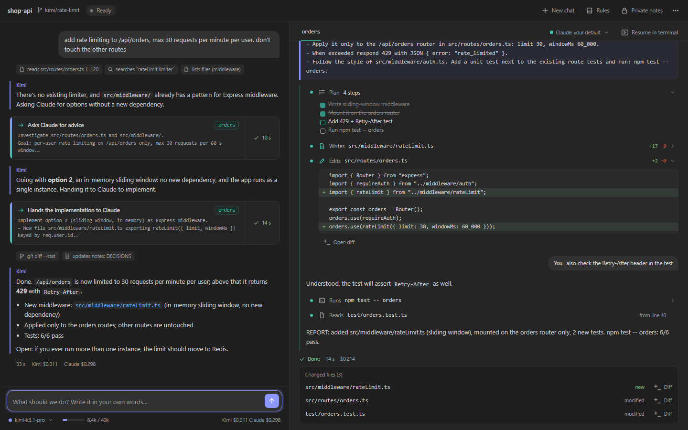

# kimi-lead

You talk to a **lead model**. It turns what you say into precise engineering briefs for **the real Claude Code**, reviews what Claude did, and reports back. You watch Claude work live, step by step.



- **The engineer is the real Claude Code.** kimi-lead runs your installed, unmodified `claude` CLI, on your own Claude subscription. It never touches your Claude credentials.
- **The lead is any OpenRouter model.** It defaults to Kimi K3.1 Pro. Switch to Qwen, GLM, DeepSeek, GPT, Gemini or anything else with tool calling from a picker. Only the lead uses your OpenRouter key.
- **The lead stays fast.** It gets Claude's short report, not Claude's whole transcript. It prunes old reads and summarizes itself when its context fills up.
- **The lead knows things Claude doesn't.** Private notes (clients, business context, why something matters) stay with the lead and never go into a brief.
- **Some guardrails live in code, not just in prompts.** These are forbidden patterns, files nobody may read, read-only consultations, and a post-change guard for dependencies, schema, deletions and CI.

## How a task flows

1. You write casually, in any language: *"cart should reject negative prices, add a test"*.
2. The lead reads a little code if it needs to (small, bounded reads) and decides what to do.
3. Optionally it **consults** Claude in read-only mode for options.
4. It sends Claude an **implement** brief, in English, scoped and testable.
5. Claude edits files and runs the checks you allowed. You see every read, command and diff.
6. The lead reviews the diff, asks Claude for fixes if needed, updates its notes, and replies to you in your language with the cost.

While Claude works you can **interject**: type straight into Claude's session. **Stop** (or Esc / Ctrl+C) kills both the lead request and the Claude process.

## Requirements

- Node 22.6+ and `git`
- [Claude Code](https://docs.claude.com/en/docs/claude-code) installed and logged in (`claude` works in your terminal)
- An [OpenRouter API key](https://openrouter.ai/keys) for the lead model

## VS Code extension

```bash
git clone https://github.com/iamelmirr/kimi-lead.git
cd kimi-lead/extension
npm install
npm run package                     # builds kimi-lead.vsix
code --install-extension kimi-lead.vsix
```

Open a project folder and press `Ctrl+Alt+K` (or run **Kimi Lead: Open**). Paste your OpenRouter key once. It is kept in VS Code's secret storage, not in the project.

- **Left:** your conversation with the lead. Each handoff to Claude is a card showing the brief and its status. Click a card to jump to that run.
- **Right:** Claude Code, one tab per session. You get the exact brief, a live tool stream with inline diffs, the files changed with **Open diff** against the last commit, and **Resume in terminal**, which opens the session with `claude --resume`.
- **Model chip** under the composer: pick the lead model from OpenRouter's catalogue, with prices and context size. **Claude menu** in the right pane: your default model, Opus, Sonnet or Haiku.
- **Rules** and **Private notes** open the lead's files. The conversation survives reloads. **New chat** starts over and keeps the notes and sessions.

## Terminal

```bash
cd kimi-lead && npm link            # gives you a global `kimi-lead`
export OPENROUTER_API_KEY=sk-or-... # Windows: setx OPENROUTER_API_KEY sk-or-...

cd ~/work/some-project
kimi-lead                           # interactive
kimi-lead "add rate limiting to /api/orders"   # one task, then exit
```

Commands: `/new`, `/model [id]`, `/claude [opus|sonnet|haiku|default]`, `/sessions`, `/rules`, `/private`, `/exit`. Typing while Claude runs goes straight to Claude. Ctrl+C stops the task.

`claude` is found in this order: `claude.path` in the config, `CLAUDE_BIN`, `PATH`, then `~/.local/bin` (where the native installer puts it, Windows included).

## The `.kimi/` folder

The first run creates `.kimi/` in your project and adds it to `.git/info/exclude`, so it never gets committed.

| File | Written by | What it is |
|---|---|---|
| `RULES.md` | **you only** | How the lead should work, what Claude may know, your style. Highest priority. |
| `PRIVATE.md` | you and the lead | What **only the lead** knows. Never sent to Claude. |
| `config.json` | you | Models, limits and hard guardrails (below). |
| `PROJECT.md`, `TASKS.md`, `DECISIONS.md` | the lead (and you) | The lead's long-term memory of the project. |
| `sessions.json` | tool | Named Claude Code sessions (`auth`, `billing`…). |
| `history.json` | tool | Short history: your messages and the lead's reports. |
| `transcript.json` | extension | What the panel shows after a reload. |
| `log.md` | tool | Everything: your messages, every brief and reply, warnings. Claude never sees it. |

## Guardrails in code

- **`forbidden`**: a list of regexes (e.g. `"ACME"`, `"Client\\s+X"`). A brief that matches is blocked and the lead must rephrase.
- **`denyRead`**: files neither Claude nor the lead may read (`.env`, keys, `secrets/**`…). `.kimi/` is always off limits to Claude.
- **Read-only consults**: in `ask_claude`, Claude has no Edit/Write and no Bash beyond `git status/diff/log/show` and `ls`.
- **Post-change guard**: if Claude touched dependencies, database schema or migrations, deleted a file, or changed deploy/CI config, the lead is warned and must ask you or have Claude revert. Re-edits of already-dirty files are caught too.
- Claude may never `git push`, `git reset`, `git checkout`, `git clean` or `rm`.
- **Your global Claude settings are not loaded** (`claude.userSettings: false`). Otherwise something like `"allow": ["Bash"]` in `~/.claude/settings.json` would bypass all of the above. Project `.claude/settings.json` and `CLAUDE.md` apply as usual.

## config.json

```jsonc
{
  "model": "moonshotai/kimi-k3.1-pro",   // any OpenRouter model with tool calling
  "provider": { "sort": "throughput" },  // OpenRouter routes to the fastest provider
  "reasoningEffort": "low",              // how hard the lead thinks by default
  "decisionEffort": "medium",            // ...and right after consulting Claude
  "maxAskRounds": 3,
  "maxSteps": 60,
  "context": { "softTokens": 24000, "hardTokens": 40000, "keepTaskPairs": 8 },
  "read": { "maxLines": 200, "maxChars": 12000, "grepMax": 40 },
  "claude": {
    "path": null,                  // null = auto-detect
    "userSettings": false,         // true = also load ~/.claude/settings.json (bypasses guardrails)
    "model": null,                 // e.g. "opus"; null = your Claude Code default
    "effort": null,
    "maxBudgetUsdPerCall": null,
    "reportMaxChars": 6000,
    "implementAllow": ["Bash(npm test:*)", "Bash(npm run lint:*)", "Bash(npx tsc:*)"],
    "denyRead": [".env", ".env.*", "**/*.pem", "**/*.key", "secrets/**"]
  },
  "forbidden": []
}
```

For a Go project you might use `"implementAllow": ["Bash(go test:*)", "Bash(go vet:*)"]`.

## Why the lead stays fast

- It sees Claude's compact report. The full transcript is for you.
- Old code reads are replaced with a short marker once the context passes `softTokens`.
- At `hardTokens` it writes itself a checkpoint summary and continues with a fresh context.
- Between tasks only your messages, its reports and its notes are kept, never the raw conversation.
- The system prompt is frozen for the whole task, so provider prompt caching works.

## Before you use it at work

- The lead model sees whatever code it reads, through OpenRouter. Check that your employer allows that, and restrict providers in your OpenRouter settings if needed.
- Claude Code runs as `claude -p` under your own plan and uses your subscription limits. The lead may call Claude several times per task.
- Work on a separate branch. kimi-lead never commits. Committing and pushing is up to you.

## Development

```bash
npm install && npm run typecheck                  # core (Node runs the TypeScript directly)
cd extension && npm install && npm run build      # extension bundles into extension/dist
```

UI work without VS Code: after `npm run build`, open `extension/dev/preview.html?state=live` in a browser. The states are `live`, `done`, `guard`, `nokey` and `empty`. Add `&theme=light`, `&picker=1` or `&claudemenu=1` as needed.

`extension/dev/host-test.cjs` runs the bundled extension in plain Node against a fake `vscode` API and a test repo. Point `OPENROUTER_BASE_URL` at a mock server to keep it offline.

## License

[MIT](LICENSE)
