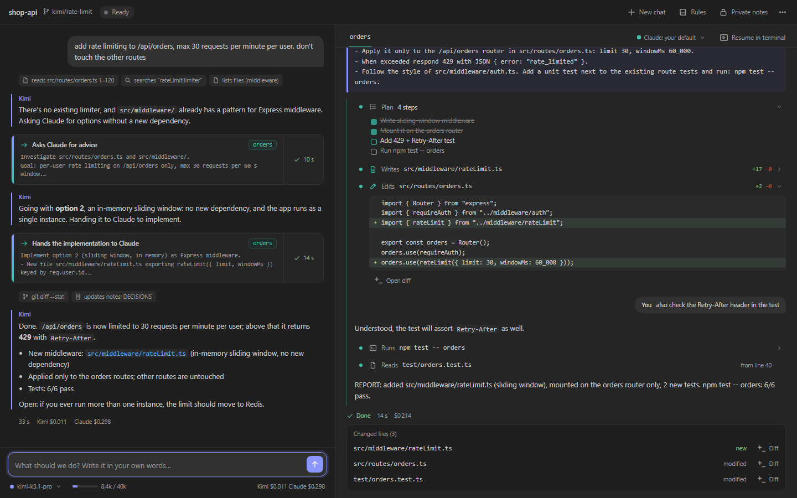

# Briefwise for VS Code

Talk to a lead model in your own words. It turns your request into a precise brief for the real Claude Code, and you watch Claude work live, right next to the conversation.



- **Left:** your conversation with the lead, any OpenRouter model with tool calling (Kimi by default). Write in any language; it replies in yours and briefs Claude in English.
- **Right:** Claude Code, one tab per session. You see the exact brief, every file Claude reads, every command, and every edit with an inline diff. Type into the session while it runs, stop it, or resume it in a terminal.
- **Your Claude subscription:** Briefwise runs your installed, unmodified `claude` CLI under your own login. It never touches your Claude credentials. The OpenRouter key is only for the lead.
- **Private notes:** context you give the lead stays in `PRIVATE.md` and is never sent to Claude.
- **Guardrails in code:** forbidden patterns, files nobody may read, read-only consultations, and a guard for dependency, schema, deletion and deploy/CI changes.

## Requirements

- VS Code 1.95 or newer
- [Claude Code](https://docs.claude.com/en/docs/claude-code), installed and signed in (`claude` works in your terminal)
- `git`, and a project that is a git repository
- An [OpenRouter API key](https://openrouter.ai/keys)

## Install

Download [`briefwise.vsix`](https://github.com/iamelmirr/briefwise/releases/latest/download/briefwise.vsix) from the latest release, then:

```bash
code --install-extension briefwise.vsix
```

Or open the Extensions view, click `...`, and choose **Install from VSIX...**.

## Quick start

1. Open a project folder.
2. Press `Ctrl+Alt+K` (`Cmd+Alt+K` on macOS), or run **Briefwise: Open**.
3. Paste your OpenRouter key into the panel. It is kept in VS Code's secret storage, not in the project.
4. Describe a task, for example "cart should reject negative prices, add a test".

Start on a clean branch. Briefwise never commits or pushes.

## Commands

| Command | Description |
|---|---|
| **Briefwise: Open** (`Ctrl+Alt+K` / `Cmd+Alt+K`) | Open the panel for the current project |
| **Briefwise: Set OpenRouter key** | Save or replace the OpenRouter key |
| **Briefwise: Clear OpenRouter key** | Remove the saved key |
| **Briefwise: Stop task** | Stop the lead and the running Claude process (also `Esc` in the panel) |
| **Briefwise: New conversation** | Clear the conversation; notes and sessions are kept |

In the panel, the model chip under the message box switches the lead model, and the **Claude** menu above the Claude pane picks your default, Opus, Sonnet or Haiku.

## Settings

Briefwise has no VS Code settings. Each project's configuration lives in `.briefwise/config.json`, next to your rules and the lead's notes. Open it from the panel's `...` menu > **Settings (config.json)**. The folder is excluded from git automatically.

The setting you will most likely change first is `claude.implementAllow`, the commands Claude may run when implementing (your tests, linter, type checker).

## Documentation

- [Getting started](https://github.com/iamelmirr/briefwise/blob/main/docs/getting-started.md)
- [Rules and notes](https://github.com/iamelmirr/briefwise/blob/main/docs/rules-and-notes.md)
- [Configuration](https://github.com/iamelmirr/briefwise/blob/main/docs/configuration.md)
- [Models](https://github.com/iamelmirr/briefwise/blob/main/docs/models.md)
- [How it works](https://github.com/iamelmirr/briefwise/blob/main/docs/how-it-works.md)
- [Troubleshooting](https://github.com/iamelmirr/briefwise/blob/main/docs/troubleshooting.md)
- [FAQ](https://github.com/iamelmirr/briefwise/blob/main/docs/faq.md)

## Before you use it at work

The lead model sees the code it reads, through OpenRouter. Claude Code uses your subscription's limits. Check that both fit your employer's policy.

## License

[MIT](https://github.com/iamelmirr/briefwise/blob/main/LICENSE)
